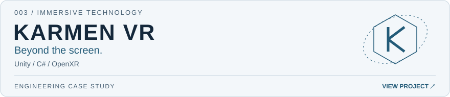

<picture>
  <source media="(prefers-color-scheme: dark)" srcset="./assets/header-dark.svg">
  
</picture>

## About

I'm a software developer based in the Basque Country, interested in artificial intelligence, software architecture and the infrastructure behind applications. I enjoy working across the stack, from application logic to deployment and networking.

My long-term interest is building intelligent systems that give people more control over their technology.

## Selected work

Public engineering case studies of projects currently in development. Source repositories remain private.

<a href="https://github.com/beinatmartin/karmen-showcase">
  <picture>
    <source media="(prefers-color-scheme: dark)" srcset="./assets/project-karmen-dark.svg">
    
  </picture>
</a>

<a href="https://github.com/beinatmartin/goikol-showcase">
  <picture>
    <source media="(prefers-color-scheme: dark)" srcset="./assets/project-goikol-dark.svg">
    
  </picture>
</a>

<a href="https://github.com/beinatmartin/karmen-vr-showcase">
  <picture>
    <source media="(prefers-color-scheme: dark)" srcset="./assets/project-karmen-vr-dark.svg">
    
  </picture>
</a>

## Technical interests

| Area | Technologies and topics |
| --- | --- |
| Application development | Python, C#, Java, PHP, Laravel |
| Data | SQL, MySQL |
| Infrastructure | Linux, Docker, Git, GitHub Actions |
| Interactive systems | Unity, virtual reality |
| Currently exploring | Local AI inference, robotics, autonomous systems |

---

*Independent by design.*
