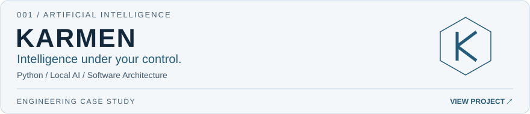
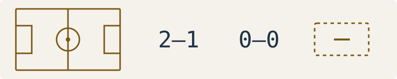

# Beñat Martín Ulanga

**Technology is what I build. People are why I build it.**

I'm a software developer from the Basque Country. I want to build technology that helps people feel safe, respected and connected — technology that brings us closer to life, not further away from it.

<picture>
  <source media="(prefers-color-scheme: dark)" srcset="./assets/header-dark.svg">
  
</picture>

## Selected work

### [KARMEN](https://github.com/beinatmartin/karmen-showcase) · Personal AI

*Intelligence under your control.*

What if a device carries out your request, but its reply never comes back? A retry could make it act twice. In Karmen, the model proposes an action, the core checks whether it’s allowed, and the tool handles execution. If an action may already have taken effect, Karmen records the outcome as uncertain and avoids an automatic retry.

<picture>
  <source media="(prefers-color-scheme: dark)" srcset="./assets/project-karmen-dark.svg">
  
</picture>

Local inference and supervised tools are part of the stable foundation. Cross-device continuity is in development. A complete physical setup still needs validation.

### [GOIKOL](https://github.com/beinatmartin/goikol-showcase) · Applied software engineering

*Engineering fair competition.*

GOIKOL is a sports prediction app for an educational community. Imagine two matches finish on Saturday and the third is postponed. The organiser can record the first two results and award points. When the last result comes in, GOIKOL scores that match and skips the two it has already scored.

<picture>
  <source media="(prefers-color-scheme: dark)" srcset="./assets/project-goikol-dark.svg">
  
</picture>

CI runs passed the MySQL-backed test suite in the reviewed development snapshot. One run also published container images and verified their digests. Revalidation under the current repository identity is pending, and deployment to the target host remains unverified.

### [KARMEN VR](https://github.com/beinatmartin/karmen-vr-showcase) · Immersive experiences

*A machine waiting to wake up.*

In this escape room, you enter a damaged science-fiction facility. The plan is for each battery you recover to bring a fictional AI companion a little closer to waking up. What interests me is how much a player can learn about a room by reaching for something in it.

<picture>
  <source media="(prefers-color-scheme: dark)" srcset="./assets/project-karmen-vr-dark.svg">
  
</picture>

Quest 2 is the target headset, and the escape room is designed to be playable in Basque. The current gameplay logic runs locally. A full playthrough on the headset still needs verification, and integration with Karmen Core is future work.

## How I approach engineering

These are five principles I’m learning to apply.

- **Keep people in control.** In Karmen, saving a personal memory requires consent. A person can review it, correct it or ask for it to be deleted.
- **Design for failure.** When testing a timeout, I care about which side of dispatch it happened on. That changes what Karmen can safely do next.
- **Own what matters.** Karmen can use a local model. Keeping memory separate from the inference provider lets the two evolve independently.
- **Make complexity useful.** In GOIKOL, separating results from scoring gives an organiser a simple choice when a match is postponed. They can leave it pending.
- **Be precise about progress.** The Unity project shows which XR tools I’ve configured. A separate headset test is needed to judge how the game plays.

## Beyond the code

I’d like someone trying their first escape room to hear a hint in Basque and feel at home. That’s one way my Basque roots shape what I build. I want people to feel safe asking for help and to have room to decide what to do next.

I’m curious about the infrastructure that makes software dependable and about what robotics could offer beyond a screen. I still have a lot to learn. A tool that gives someone more time or confidence to do something with another person would be worth building.

## Let's connect

If you’re working on AI, robotics or software that gives people more control, I’d like to hear about a design decision you’re wrestling with.

Independent by Design. Human by Purpose.
